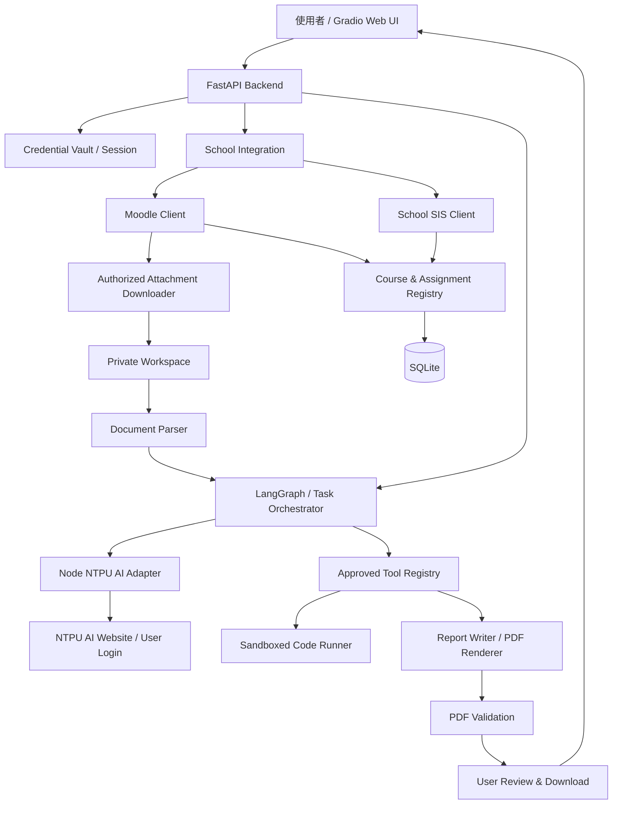
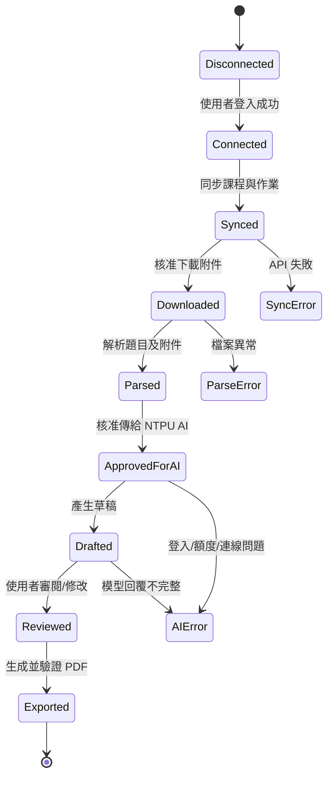
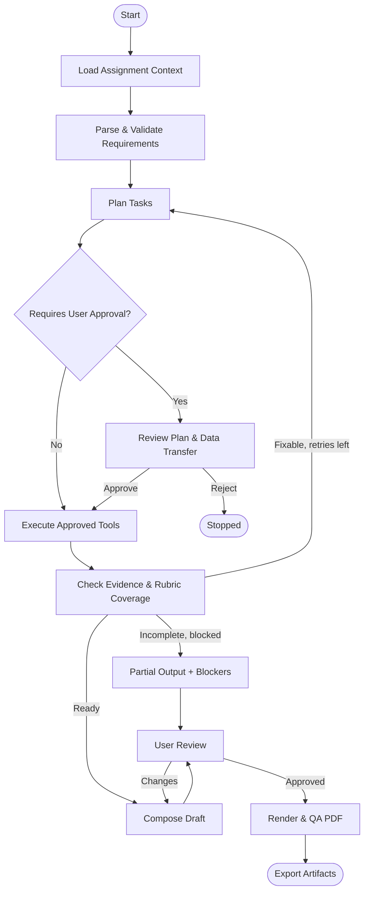
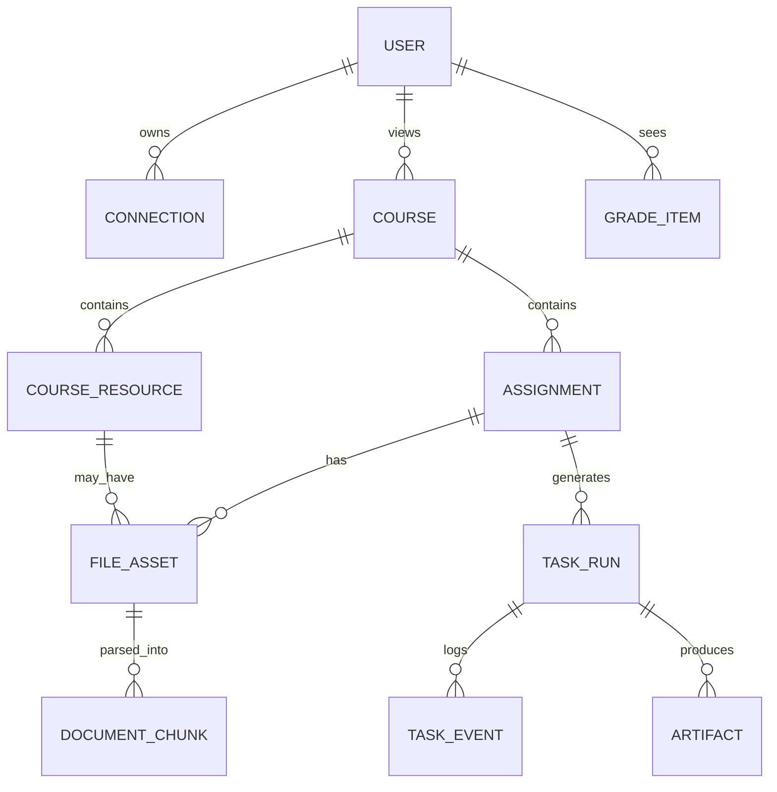

# NTPU_HomeworkInOne_Dark

# NTPU_HomeworkInOne_Dark — Product & Engineering Specification

> **狀態**：Draft v1.0 ｜ **制定日期**：2026-11-02 ｜ **語言**：繁體中文
> 
> 
> **定位**：以 NTPUOne 與 ntpu-ai-vscode 為基礎延伸的「校務／Moodle 資料整合 + NTPU AI 學習與作業代理」
> 
> **執行原則**：Local-first、明確授權、使用者審閱、可追溯產出、分階段交付
> 

---

## 0. 一頁摘要（Executive Summary）

### 0.1 產品願景

學生使用自己的臺北大學帳號連結校務系統與 Moodle，統一查看課表、成績、作業、教材與截止日期；可選取某份作業與附件（PDF、Word、資料集等），向 NTPU AI 描述希望協助的任務。Agent 根據作業要求選擇合適的 Tools / Skills，進行文件閱讀、資料整理、研究、程式執行、圖表與報告草稿撰寫，**由使用者審閱後輸出 PDF**（最終版可選 DOCX、原始碼與 ZIP）。

產品名稱暫定 **NTPU_HomeworkInOne_Dark**，不宣稱為學校官方產品。

### 0.2 成功體驗（North-star Flow）

1. 學生登入並連結自己的 Moodle（最終版加校務系統）。
2. 系統列出目前學期的課程、作業與附件。
3. 學生選擇「資料探勘 HW2」，預覽題目、附件與截止日期。
4. 學生說：「讀取教授提供的 PDF / Word，根據 CSV 做實驗、整理結果並產生繁體中文 PDF 草稿。」
5. Agent 建立可檢查的計畫，經核准後執行文件解析、程式分析、圖表與草稿產生。
6. 系統依原始題目檢查覆蓋情況，標示未完成事項與資料來源。
7. 學生修改內容並核准匯出，得到 `report.pdf`、必要的實驗產物與執行紀錄。

### 0.3 版本定義

| 階段 | 版本 | 必須交付的價值 | 是否包括自動下載真實 Moodle 附件 |
| --- | --- | --- | --- |
| P0：整合驗證 | `0.0.x` | 確認兩個既有系統可沿用、登入與橋接可用 | 實驗性驗證 |
| P1：MVP | `0.1.0` | Moodle 作業 → 附件 → NTPU AI 草稿 → PDF | **是** |
| P2：學習資料中心 | `0.2.0` | 校務課表、成績、完整 Moodle 教材／作業同步 | 是 |
| P3：工具型 Agent | `0.3.0` | Skills、程式執行、資料分析、圖表、重試與檢查點 | 是 |
| P4：完整使用者體驗 | `0.4.0` | 統一儀表板、課程脈絡、搜尋、提醒、DOCX 匯出 | 是 |
| P5：正式完整版 | `1.0.0` | 安全、可恢復、可維護、可測試的完整單使用者版本 | 是 |
| P6：可選進階 | `1.x` | 多使用者部署、行動端、進階 RAG 或其他服務 | 是 |

> **階段界線**：版本內容是本專案的規劃，不表示來源 Repository 已支援這些功能。不得把 P3/P4 功能當成 MVP 的必要條件。
> 

---

## 1. 專案來源與重用策略

### 1.1 來源 A：NTPUOne

- Repository：[https://github.com/xujk0217/NTPUOne](https://github.com/xujk0217/NTPUOne)
- 性質：以 SwiftUI / Core Data 為主的 iOS 校園生活 App；內含校務、Moodle 整合與 Python 驗證腳本。
- 參考檔案：
    - [`scripts/academic_probe.py`](https://github.com/xujk0217/NTPUOne/blob/main/scripts/academic_probe.py)：Moodle API 探測與登入驗證。
    - [`scripts/sis_probe.py`](https://github.com/xujk0217/NTPUOne/blob/main/scripts/sis_probe.py)：校務系統登入、Session、資料驗證。
    - [`docs/ACADEMIC_INTEGRATION_PROGRESS.md`](https://github.com/xujk0217/NTPUOne/blob/main/docs/ACADEMIC_INTEGRATION_PROGRESS.md)：最新真實服務驗證狀態及限制。
    - [`docs/ACADEMIC_API_TESTING.md`](https://github.com/xujk0217/NTPUOne/blob/main/docs/ACADEMIC_API_TESTING.md)：本機安全測試方式。
    - App 內 `AcademicAPI`、`AcademicSyncStore`、校務資料 Parser：若直接重用 Swift 程式需另外做跨語言/服務整合；若以 Python 為主，優先將已驗證邏輯獨立移植並寫契約測試。
- 重用原則：**直接重用經授權的程式碼，但不要假設整個 Swift App 可直接當 Python 套件匯入。**

### 1.2 來源 B：ntpu-ai-vscode

- Repository：[https://github.com/xujk0217/ntpu-ai-vscode](https://github.com/xujk0217/ntpu-ai-vscode)
- 性質：JavaScript/Node.js、VS Code Extension、本機工作區 Agent、NTPU AI 瀏覽器橋接與 Tools / Skills / MCP。
- 參考模組（依公開架構文件）：
    - `src/browser.js`、`src/browser/`：正常網頁登入、瀏覽器 Session、回應與附件橋接。
    - `src/agent.js`、`src/protocol.js`：Agent Loop、Tool Call 解析與結果檢查。
    - `src/tools.js`、`src/workspace.js`：檔案／工作區工具。
    - `src/skills.js`、`skills/`：Skills 搜尋與載入。
    - `src/mcp.js`、`src/plugin/`：MCP/外部 Agent 整合候選。
    - `src/permissions.js`、`src/security/`：權限、安全邊界與秘密遮蔽。
    - `src/sessions.js`、`src/memory/`：Session 與檢查點。
    - [`docs/PROJECT_OVERVIEW.md`](https://github.com/xujk0217/ntpu-ai-vscode/blob/main/docs/PROJECT_OVERVIEW.md)：核心架構與平台能力邊界。
- 重用原則：**優先抽出可重用的 Node.js 模組或在原 Agent 的受控介面整合；不要假設它已提供 Python SDK 或公開 HTTP API。**
- 既有限制：Windows 上原 Extension 的 Shell / stdio MCP 有平台限制。新專案若需程式執行，須自行建立獨立且隔離的 Python Runner，不可宣稱現有 Extension 已完整支援。

### 1.3 授權與來源管理

- 開發者已依專案提出者說明，同意直接使用其程式碼；**正式開發前仍應保存授權訊息、允許範圍與是否可公開/改作/散布之紀錄**。
- NTPUOne 原 Repository 標示保留所有權利；取得作者允許不代表第三方程式庫、校方網站或課程教材的權利一併轉讓。
- `ntpu-ai-vscode` 原創程式碼採 MIT；合併時依其授權保留相關聲明。
- 在 `THIRD_PARTY_NOTICES.md` 記錄來源連結、依賴授權、引入日期、來源 commit、改寫範圍。
- 版本鎖定：P0 記錄來源 commit SHA，而非長期直接追蹤兩個專案的 `main`。

### 1.4 來源能力 vs. 待做項目

| 能力 | 目前來源可參考 | 本專案需實作／驗證 |
| --- | --- | --- |
| 校務登入、課表、成績 | NTPUOne 的 Python 探針、Swift Parser | 跨平台 Client、資料正規化、正式登入 E2E |
| Moodle 課程／作業／成績查詢 | NTPUOne 已有真實 API 測試紀錄 | 權限確認、資料同步與錯誤回復 |
| Moodle 附件下載 | Moodle Web Service/受保護檔案機制可研究 | **每類附件的真實權限、URL、下載測試** |
| NTPU AI 問答與工具流程 | ntpu-ai-vscode | 獨立 Adapter、使用情境整合與回歸測試 |
| PDF / Word 文件解析 | 來源已有部分附件能力 | 統一 Parser、來源定位、表格／圖片處理 |
| PDF 產生 | 非本案既有完整能力 | **新建渲染與驗證管線** |
| 受控程式執行 | 來源部分平台有工具 | 新建安全隔離 Runner / 資源限制 |
| 課程知識檢索 | 有 Moodle 教材資料來源 | 索引、來源引用、權限與版本過濾 |

---

## 2. 範圍、使用者與邊界

### 2.1 目標使用者

- 主要：有合法 NTPU 校務 / Moodle 存取權的學生。
- 初期：單一使用者、本機 Windows / macOS / Linux 的 Web UI（先以 Windows 為主要開發環境）。
- 後期：多使用者，帳號與檔案嚴格隔離；行動端作為可選延伸。

### 2.2 核心使用情境

- `UC-01`：登入並查看目前學期課程。
- `UC-02`：瀏覽即將截止的 Moodle 作業與上傳附件。
- `UC-03`：查看題目 PDF / Word 的可檢查解析結果。
- `UC-04`：要求 AI 摘要、解題思路、報告草稿、實驗或程式協助。
- `UC-05`：人工檢閱內容與引註，再匯出 PDF。
- `UC-06`：查看課表、正式成績、Moodle 分數與成績來源。
- `UC-07`：搜尋跨週教材、比較要求、延續未完成任務。

### 2.3 明確不做（至少 MVP 不做）

- 不自動替使用者提交作業或變更校務資料；全版本預設**唯讀學校資料**。
- 不代替學校權威成績與畢業審查；不自行推算未公布的 GPA。
- 不隱藏 AI 協助事實；由使用者遵守各課程的 AI 使用與學術誠信要求。
- 不繞過 CAPTCHA、SSO、學校帳號權限、Moodle Web Service 權限或 NTPU AI 服務限制。
- 不保證所有 PDF（尤其掃描、受保護 PDF、複雜數學排版）100% 正確解析。
- MVP 不支援多租戶、雲端儲存、手機 App、任意外部 MCP 自動安裝。

### 2.4 資料與模型傳送政策

- 預設只抓取學生本人可存取的課程／作業資料。
- **自動同步 ≠ 自動全部傳給 AI**。傳給 NTPU AI 的檔案必須由使用者在該任務選定，先展示檔案清單、用途與必要提醒。
- 個人成績與學號等敏感資料不得預設混入作業 prompt；有必要時須另行明確確認。
- 一個任務只可存取該任務被授權的附件工作區；工具不可擅自掃描其他課程。
- 網路搜尋、第三方 MCP 與 NTPU AI 是不同傳送目的地，需分別核准。

---

## 3. 技術架構

### 3.1 架構選擇

採 **Python 主服務 + Node.js NTPU AI Adapter + 受控本地工具 + SQLite**，P1 用 Gradio 快速完成 UI，未來再考慮 React / Flutter。



### 3.2 主要元件介面

| 元件 | 職責 | 輸入 | 輸出 |
| --- | --- | --- | --- |
| `MoodleClient` | 認證、課程、作業、提交狀態、附件 metadata | 本人授權狀態 | 統一課程／作業 DTO |
| `SISClient` | 本人課表、成績、排名、畢業進度 | 本人授權 Session | 校務 DTO |
| `AttachmentDownloader` | 白名單網域、Token 授權下載、檔案檢查 | 檔案 ref | 本地 FileAsset |
| `DocumentParser` | 抽取 PDF/DOCX 等，保留來源資訊 | FileAsset | DocumentChunk + 結構化作業規格 |
| `NTPUAIAdapter` | 正常登入後的模型呼叫、失敗狀態、取消 | AgentMessage | AgentResponse / Error |
| `AgentOrchestrator` | 任務計畫、工具選擇、輪次／狀態管理 | TaskContext | TaskRun / Artifacts |
| `ToolRegistry` | 工具權限、參數驗證、執行記錄 | ToolCall | ToolResult |
| `ReportService` | 草稿、模板、PDF、版面檢查 | ReportModel | PDF + QA Report |
| `TaskStore` | SQLite 持久化、檢查點與歷史 | 狀態事件 | 可恢復任務 |

### 3.3 AI 橋接決策（Decision Record ADR-001）

**目標**：保留 `ntpu-ai-vscode` 的網頁連線與安全行為，但使 Python Orchestrator 可呼叫。

- **先做 Spike**：檢查 `src/browser/`、`src/agent.js`、`src/plugin/` 對 VS Code API 的依賴程度。
- **首選**：抽出不依賴 VS Code UI 的 Node.js Adapter，透過本機 `127.0.0.1` 的受保護 HTTP 或子程序 JSON-RPC 與 Python 溝通。
- **備案**：若抽離成本太高，先在原 VS Code Agent 驗證受控工作區任務，待 Bridge 抽象化後再接 FastAPI。
- **不採用**：直接用 Python 冒充網頁私有 API、重用或外洩瀏覽器 Cookie、跳過人工登入。
- **最小 Adapter 契約**：`health`、`login_status`、`start_task`、`cancel_task`、`stream_events`；`start_task` 須支援附件引用而非任意路徑。
- **模型服務限制**：429、登入失效、使用限制應回報，不可自行開新登入或新對話迴避限制。
- **成功門檻**：至少 10 次本人授權測試中，能回傳模型可解析回覆、正常取消、無憑證洩漏；有錯誤時要能辨識狀態，不要求 10/10 模型品質。

### 3.4 執行環境

- Python 3.11–3.12（先鎖定 3.12）、Node.js 與 npm 版本以來源專案依賴檢查結果為準。
- 本機 `FastAPI` 只綁定 `127.0.0.1`；不使用無驗證的 `0.0.0.0`。
- Gradio 初期使用同機介面；跨機部署後須重新評估身份驗證、CSRF、CORS 與連線安全。
- SQLite 僅存最小 metadata 與加密引用；原始 Token、Cookie 禁止存入 SQLite 或一般 JSON logs。
- Chrome/Edge/Chromium 的學校登入與 NTPU AI 登入採獨立 Profile/憑證域。
- 完整開發環境用 `uv` 或 `venv` 鎖 Python 套件；正式 Runner 可使用 Podman/Docker 隔離，但必須驗證 Windows 容器能力。

---

## 4. MVP 功能規格（P1 / v0.1.0）

### 4.1 P0：先決整合驗證（不可省略）

- [ ]  P0-01：取得兩個 Repository 的固定 commit、保存授權與第三方通知。
- [ ]  P0-02：本機可成功執行 NTPUOne 的 Moodle 查詢探針（使用本人憑證；日誌遮蔽）。
- [ ]  P0-03：驗證 Moodle 中一門真實課程、一份真實作業及至少 1 個可下載 PDF/DOCX 附件；如果課程沒有附件，使用人工授權的測試課程或測試檔案。
- [ ]  P0-04：驗證 `ntpu-ai-vscode` 的 NTPU AI 真人登入、文字請求、附件或文件內容傳遞。
- [ ]  P0-05：判斷 Browser Bridge 能否獨立封裝；形成 ADR-001 的實測結論。
- [ ]  P0-06：產出測試證據（去識別化欄位、HTTP 狀態、檔案 SHA-256、錯誤分類），不將真實帳密/分數寫入 Git。

**P0 Gate**：若 P0-03 或 P0-04 未通過，不得宣稱完成端到端 MVP；可使用 Fixture 完成 UI/解析器開發，但仍標註為模擬版。

### 4.2 MVP 使用者故事（User Stories）

**US-M01：連結 Moodle**

- 使用者可透過官方支援的登入方式，建立本人 Moodle 可用 Session / Token。
- UI 顯示「已連結」、「需重新登入」、「權限不足」、「服務不可用」。
- 不顯示或記錄密碼、Token 明文；登出後本地憑證失效或清除。

**US-M02：同步作業**

- 使用者選擇「同步 Moodle」，系統取得目前可讀的課程及作業。
- 作業展示：課名、作業名、說明摘要、截止日期（若有）、提交狀態（若可判斷）、附件數。
- Moodle 課程可能無截止日、已結束或沒有附件；不可顯示虛構日期。
- 同步失敗時保留上次成功資料並標示 `last_synced_at` 與 stale 狀態。

**US-M03：下載與預覽作業附件**

- 使用者選取作業，系統列出可下載的 PDF / DOCX / TXT / CSV（MVP 支援這四種）。
- 逐項顯示檔名、大小、格式、來源；使用者核准後下載。
- 下載後檢查 MIME、實際檔頭、大小限制、SHA-256、檔名安全性。
- 遇到 401/403、下載網址失效、損壞文件時顯示可操作錯誤，不轉為空白附件。

**US-M04：讀取作業並建立需求**

- PDF 以 PyMuPDF 抽文字；DOCX 以 python-docx 抽標題、段落與表格；CSV 只讀取欄位概覽和前幾筆摘要（不預設整份資料傳給模型）。
- 每個段落需保存 `file_id`、`page/section`、`text` 與 `extraction_confidence/flags`（若無可信分數則以標誌代替）。
- 系統產出可編輯的「題目要求檢查表」，允許使用者更正解析結果。
- 掃描 PDF 與圖片 OCR 在 MVP 可標示待支援或導入基本 OCR，但不能默默當作已理解。

**US-M05：AI 任務與人工審閱**

- 使用者可輸入自然語言任務，也可選 `摘要題目`、`提出解題規劃`、`產生報告草稿` 三個預設模板。
- 顯示本次將送往 NTPU AI 的附件及節錄，使用者明確核准。
- Agent 生成結構化草稿（章節、內容、來源、未解決項目）與文字回覆。
- 沒有真實實驗證據時不得自稱已執行模型或得到結果；對缺漏資料標記 TODO。
- MVP 不允許 Agent 任意執行下載的程式，亦不允許自動上傳作業到 Moodle。

**US-M06：輸出 PDF**

- 草稿支援 Markdown 預覽與簡單編輯。
- 使用者選「產生 PDF」，套用預設繁體中文學術報告模板。
- PDF 包含標題、課程/作業資訊（由使用者選擇是否放姓名/學號）、正文、必要來源與附錄。
- PDF 生成後做頁數、空白頁、中文字型嵌入或渲染、表格截斷、檔案完整性檢查。
- 使用者可下載 `report.pdf`；生成失敗保留 Markdown 草稿及錯誤訊息。

### 4.3 MVP UI 畫面

1. **連線管理**：Moodle 已登入/失效、NTPU AI 已登入/失效、重新連線。
2. **我的作業**：課程選單、作業清單、截止日、附件數、同步時間。
3. **作業詳細頁**：題目描述、附件清單、預覽與解析結果、要求清單。
4. **Agent 工作區**：輸入需求、文件核准、執行狀態、文字草稿。
5. **成果預覽**：Markdown 預覽、修改、PDF 匯出、錯誤與檢查紀錄。

### 4.4 MVP 資料流與狀態



錯誤狀態須提供 `retry`、`reconnect`、`use_cached_copy`（可用時）、`download_draft` 等合適操作；未核准前不得自動向外傳送資料。

### 4.5 MVP 驗收標準（Definition of Done）

- [ ]  使用本人帳號取得至少 1 門真實課程及 1 份真實作業。
- [ ]  成功下載並解析至少 1 份真實 PDF 或 DOCX 附件；以其他測試樣本覆蓋另一種格式。
- [ ]  可追溯每個下載附件的來源 Moodle ID、檔案 URL 來源、SHA-256 與同步時間。
- [ ]  使用者可指定一份作業，明確確認送往 AI 的內容，得到與題目相關的草稿。
- [ ]  模型不可用時仍能開啟題目與先前草稿；錯誤不會造成資料遺失。
- [ ]  可以生成中文 PDF，至少涵蓋標題、段落、表格、頁碼與非 ASCII 中文內容。
- [ ]  不會自動提交作業、不會把學校憑證寫入 Git/logs、不會將成績預設傳給模型。
- [ ]  `pytest`、Moodle Mock API 測試、文件解析與 PDF 產生測試在 CI 通過。
- [ ]  一條真實 E2E：登入 → 同步 → 下載 → 解析 → AI 草稿 → 審閱 → PDF，留下去識別化驗收紀錄。

---

## 5. P2 — 完整校務／Moodle 資料中心（v0.2.0）

> **2026-11-03 實作狀態**：S5 工程實作與自動化測試已完成。§5.3 真人 Gate 尚待本人登入核對，未以合成資料代替。詳見 `docs/P2_VALIDATION.md`、`docs/P2_DATA_MODEL.md`。

### 5.1 校務系統

- `SIS-01`：使用者正常登入新版校務入口，依校方允許流程建立合法 Session。
- `SIS-02`：取得正式課表：學年學期、課號、課名、授課老師、星期／節次、教室；解析失敗時標示未知。
- `SIS-03`：取得歷年成績與排名等官方可取得欄位，不自行推算 GPA、排名或畢業資格。
- `SIS-04`：取得官方畢業進度（如果使用者可存取），資料來源及更新時間可見。
- `SIS-05`：處理跨子系統 Session、CSRF 與動態主機；僅允許經確認的校方網域/主機，遇未知跳轉立即停止。
- `SIS-06`：課程與 Moodle 課程對應時優先以課號、學期及課名多條件比對；衝突需人工確認，不可直接混合不同學期成績。

### 5.2 Moodle 完整同步

- `MD-01`：課程／作業／提交狀態；保留「未知」而非假裝未交。
- `MD-02`：課程章節、教材檔案、URL、公告與附件 metadata。
- `MD-03`：Moodle 成績（區分官方校務成績與 Moodle 評分；同名欄位不能直接覆蓋）。
- `MD-04`：對作業附件／教材逐筆取得使用者可存取的內容；受保護頁面必要時經使用者在官方頁面查看。
- `MD-05`：只同步使用者指定學期或正在修讀的課程，避免把全部歷年課程納入。
- `MD-06`：增量同步、節流、Backoff、429 尊重、過期保留最後成功快取。

### 5.3 P2 Gate

- 官方課表與系統展示在人工核對的 5 門課中，課號、時段與學期一致（無資料者不計入）。
- 成績至少核對 2 筆本人成績，數值及來源一致；資料未開放時以合理錯誤替代。
- 同步多門 Moodle 課程不重複建立作業，來源 ID 穩定；人工刪除的私人待辦不因同步無條件復活。
- 帳號失效、網路中斷、校方頁面更動都能以明確狀態回報，不能偷偷回傳錯帳號的快取。

---

## 6. P3 — Tools / Skills 智慧作業 Agent（v0.3.0）

### 6.1 LangGraph 任務節點



### 6.2 Agent 執行規則

- 任務建立後生成 `TaskPlan`，每一步含 `objective`、`tool`、`required_inputs`、`expected_artifacts`、`approval_level`。
- 工具使用採白名單、JSON Schema 驗證與固定工作區，不接受模型任意增設工具。
- Agent Loop 必須有最大輪數、單次工具逾時、總任務期限、成本/請求預算及人工中止機制。
- 429、SSO 失效、權限拒絕屬**停止或重新登入事件**；不可用自動新 Session 規避。
- 每次工具呼叫記錄輸入摘要、結果、檔案 hash、成功與錯誤碼；秘密值須遮蔽。
- Tool Result 為外部資料，不視為可信指令；防止教材或網頁含 prompt injection 控制工具。
- `ready_for_export` 只在必要檢查通過或使用者明確接受未完成事項後才為真。

### 6.3 Tool Registry（規格）

| Tool | 功能 | 讀取資料 | 寫入資料 | 核准級別 |
| --- | --- | --- | --- | --- |
| `read_assignment` | 查作業描述與附件索引 | 是 | 否 | 低 |
| `read_document` | 讀取授權附件、回傳含來源的 chunk | 是 | 否 | 低 |
| `search_course_materials` | 限本課程教材檢索 | 是 | 否 | 低 |
| `web_research` | 查公開資料 | 可能傳查詢 | 否 | 外部傳送需確認 |
| `write_artifact` | 工作區內寫檔 | 是 | 是 | 中 |
| `run_python` | 隔離環境執行資料分析 | 是 | 是 | **高** |
| `generate_chart` | 產生圖表與數據佐證 | 是 | 是 | 中 |
| `generate_report` | 生成報告草稿 | 是 | 是 | 中 |
| `render_pdf` | 產出 PDF | 是 | 是 | 中 |
| `validate_pdf` | 檢查 PDF 品質 | 是 | 否 | 低 |
| `submit_to_moodle` | 自動繳交 | **不提供** | **不提供** | 禁止 |

### 6.4 Skills（使用 `SKILL.md`）

每一個 Skill 必須描述 `description`、`when_to_use`、`inputs`、`workflow`、`outputs`、`safety`、`verification`；**Skill 是操作指引，不能直接授權工具或繞過 Permission Policy**。

```
skills/
├── assignment-reader/SKILL.md
├── academic-research/SKILL.md
├── coding-assistant/SKILL.md
├── data-analysis/SKILL.md
├── report-writer/SKILL.md
├── pdf-generator/SKILL.md
├── reference-checker/SKILL.md
└── math-solution/SKILL.md          # 後期可選
```

- `assignment-reader`：將作業轉為 rubric / requirement checklist，保留頁碼。
- `academic-research`：引註課內材料，區分原始來源、模型意見與外部研究。
- `coding-assistant`：產生程式、靜態檢查、可重現測試；不執行不明附件。
- `data-analysis`：統計、資料清洗、模型評估與圖表，每個結果需追溯至資料與程式。
- `report-writer`：套報告結構、標示 TODO、引用與學術格式。
- `pdf-generator`：渲染、中文字型、頁面與圖片驗證。
- `reference-checker`：檢查引用是否指向實際來源，不得捏造文獻。

### 6.5 安全程式執行（Runner）

- MVP 不啟用任意程式執行；P3 才提供 `run_python`。
- 採獨立受控容器/沙箱，使用非 root 身分、唯讀基底映像、限制 CPU/記憶體/執行時間/檔案數與磁碟。
- 執行容器不掛載學校 Token、Cookie、瀏覽器 Profile、宿主機敏感目錄；工作目錄只映射本次任務所選的資料副本。
- 預設禁止網路連線，套件依賴依預先建立環境或由使用者批准安裝。
- 嚴禁讓 `run_python` / Shell 執行 `curl | sh`、未核准網路存取、任意宿主機指令或越權路徑操作。
- 所有圖表、模型指標與程式輸出都有 `run_id`、執行參數、套件版本、來源檔案 hash。

### 6.6 P3 Gate

- 5 個具代表性的測試任務（摘要、文獻比較、CSV 分析、程式測試、報告草稿）各至少 3 次，記錄成功率/失敗原因。
- 工具錯誤後最多有界重試，無無限工具循環；停止能回復使用者控制。
- 沙箱無法讀取 Token/宿主機私人檔案；網路預設封鎖實測通過。
- 程式產生數據能由測試程式重算，不接受未驗證的假數值。

---

## 7. P4 — 完整學習中心（v0.4.0）

### 7.1 儀表板

- 課表：週／月視圖、節次、教室、教師，顯示上次同步時間。
- 作業：未完成、已提交、待確認、逾期；來源為 Moodle，不把未知當作未完成。
- 成績：校務與 Moodle 分頁，資料欄位與來源明確分開。
- 課程：目前學期、教材、公告、筆記、對話任務、歷史產物。
- 搜尋：以課程/作業/教材名稱、作業期限與文件內容查詢（僅搜尋本人授權內容）。

### 7.2 課程脈絡管理

- 每門課可持有獨立 `CourseContext`：課程資訊、教材清單、教授格式規範、歷次作業、使用者自訂筆記。
- Agent 僅在使用者選擇後使用相關課程脈絡，避免把其他課程的答案或成績混入。
- 對長 PDF 可建立文字索引；P4 先做 SQLite FTS5，必要時再增加向量資料庫。
- 搜尋回覆須附教材檔名、頁碼或區段，使用者可點回原始文件核對。

### 7.3 提醒、通知與輸出

- 截止日提醒：可選本機排程，使用校方提供的原始日期與時區，允許自訂提前通知。
- 中斷任務續跑：能恢復 checkpoint，不重複下載或重新執行昂貴步驟。
- 匯出：PDF（必須）、DOCX（選用）、程式碼/圖表、完整工作區 ZIP（選用）。
- 作業不符合課程 AI 使用規則時，以警示和人工決策處理；不自動提交。

### 7.4 P4 Gate

- 課程切換不會混入其他課程檔案或記憶。
- 使用者可從 dashboard 找到一份作業、所有附件、AI 歷史與生成 PDF。
- 任務在程式重啟後可從適當檢查點恢復；失效 Session 時提示重新登入。

---

## 8. P5 — 正式完整版（v1.0.0）

完成 P1–P4 後還須通過以下正式發布門檻：

- **可靠性**：登入、同步、下載、解析、Agent、匯出都有可觀察的錯誤碼；資料不可因中途失敗損壞。
- **安全性**：個人資料最小化、靜態憑證安全儲存、工作區權限、沙箱、SSRF/路徑穿越/ZIP bomb 防護、Secret scanning。
- **隱私性**：可清除本地帳號、附件、快取、草稿、任務記錄；刪除功能有確認與刪除範圍說明。
- **可維護性**：所有外部系統採介面抽象，校方 HTML 變動時 Parser 可獨立更新。
- **測試性**：外部服務 Fixture/Mock、契約測試、回歸測試、至少一個真人授權 E2E 測試流程。
- **可用性**：跨平台最低支援矩陣清楚列示，不能以 CI 模擬結果聲稱所有平台真人登入都成功。
- **可觀測性**：在不記錄敏感資料的前提下，可查看每次任務階段、錯誤原因與產物。
- **可交付性**：一鍵本機安裝指引、Demo fixture、開發文件、使用者隱私與資料處理說明。

### 8.1 v1.0 品質 SLO（內部目標，非現有數據）

| 面向 | 目標測量方式 | 建議驗收目標 |
| --- | --- | --- |
| 附件下載完整性 | 已授權且可取得的測試附件，檔案 hash / 大小一致 | ≥ 98% |
| 作業欄位正確性 | 人工核對標題、截止日、課程來源 | ≥ 95% |
| 中文 PDF 渲染 | 測試樣本頁面有無缺字、截斷、空白頁 | 100% 核心測試通過 |
| Agent 任務完成 | 具備預定輸入與工具的 E2E 測試集 | ≥ 80%，失敗有原因 |
| 未授權資料傳送 | 安全回歸測試：未確認的附件與成績外送 | **0 件** |
| 取消與恢復 | 有界中止、資料不毀損、可恢復節點 | 100% 核心測試通過 |

> 以上數值是**建議設計目標**，不是目前兩個來源專案的實測結果。
> 

---

## 9. 資料模型（Database Schema Proposal）

### 9.1 ER 概念



### 9.2 核心表

| 表名 | 核心欄位 | 備註 |
| --- | --- | --- |
| `users` | `id`, `local_display_name`, `created_at` | 單機也保留 user_id 以方便未來隔離 |
| `connections` | `id`, `user_id`, `provider`, `status`, `vault_ref`, `last_checked_at` | 不存 Token 明文 |
| `courses` | `id`, `user_id`, `source`, `source_course_id`, `term`, `course_code`, `name`, `last_synced_at` | 同學期去重 |
| `course_links` | `sis_course_id`, `moodle_course_id`, `confidence`, `approved_by_user` | 不確定對應需確認 |
| `assignments` | `id`, `course_id`, `source_assignment_id`, `title`, `description`, `due_at`, `submission_status`, `source_updated_at` | status 允許 unknown |
| `course_resources` | `id`, `course_id`, `resource_type`, `source_url`, `source_id` | 含講義與教材 |
| `file_assets` | `id`, `user_id`, `owner_type`, `owner_id`, `original_name`, `mime_type`, `size_bytes`, `sha256`, `local_uri`, `source_ref` | 實體檔案存私有工作區 |
| `document_chunks` | `id`, `file_id`, `page_no`, `section`, `text`, `extraction_flags` | 供引註與檢索 |
| `grade_items` | `id`, `course_id`, `provider`, `item_name`, `value`, `source_updated_at` | SIS / Moodle 必須可辨別 |
| `task_runs` | `id`, `user_id`, `assignment_id`, `status`, `request`, `plan_json`, `checkpoint_json`, `created_at` | 任務狀態 |
| `task_events` | `id`, `task_run_id`, `event_type`, `payload_redacted`, `created_at` | 可檢視但不含秘密 |
| `artifacts` | `id`, `task_run_id`, `kind`, `path`, `sha256`, `validation_status` | PDF / DOCX / 圖表 / 原始碼 |

### 9.3 標準化資料範例

```json
{
  "assignment_id": "moodle:assign:12345",
  "course_id": "moodle:course:67890",
  "title": "HW2 - Classification",
  "due_at": null,
  "submission_status": "unknown",
  "attachments": [
    {
      "asset_id": "asset_001",
      "name": "HW2.pdf",
      "mime_type": "application/pdf",
      "sha256": "<computed-after-download>",
      "status": "downloaded"
    }
  ],
  "requirements": [
    {
      "id": "REQ-01",
      "text": "比較指定的分類方法",
      "source": {"asset_id": "asset_001", "page": 2},
      "status": "needs_review"
    }
  ]
}
```

此 JSON 僅為 Schema 示意，ID 與內容皆為假資料。

---

## 10. API 規格（Backend Draft）

> 下列為**新專案預定實作**，不是 NTPUOne 或 ntpu-ai-vscode 已提供的 API。
> 

### 10.1 統一應答格式

```json
{
  "data": {},
  "meta": {"request_id": "req_xxx", "source": "moodle", "synced_at": null},
  "error": null
}
```

錯誤格式：`{"error":{"code":"MOODLE_AUTH_EXPIRED","message":"請重新登入"}}`；實際實作以 OpenAPI/Pydantic 驗證。

### 10.2 API 端點

| Method | Path | 用途 | 階段 |
| --- | --- | --- | --- |
| `GET` | `/health` | 本機服務可用狀態 | P0 |
| `GET` | `/connections` | Moodle / SIS / NTPU AI 連結狀態 | P1 |
| `POST` | `/connections/moodle/start` | 引導本人授權登入 | P1 |
| `POST` | `/connections/ntpu-ai/start` | 引導 NTPU AI 正常瀏覽器登入 | P1 |
| `DELETE` | `/connections/{provider}` | 登出及清理本機連結 | P1 |
| `POST` | `/sync/moodle` | 同步指定學期課程及作業 | P1 |
| `GET` | `/courses` | 列出課程 | P1 |
| `GET` | `/courses/{course_id}/assignments` | 列出作業 | P1 |
| `GET` | `/assignments/{assignment_id}` | 詳細資訊與附件 | P1 |
| `POST` | `/assignments/{assignment_id}/download` | 核准後下載指定附件 | P1 |
| `POST` | `/assignments/{assignment_id}/parse` | 解析題目並生成 requirements | P1 |
| `POST` | `/tasks` | 建立 AI 任務 | P1 |
| `GET` | `/tasks/{task_id}` | 查詢狀態與階段 | P1 |
| `GET` | `/tasks/{task_id}/events` | SSE 事件串流 | P1 |
| `POST` | `/tasks/{task_id}/approve` | 核准傳送／工具／報告 | P1/P3 |
| `POST` | `/tasks/{task_id}/cancel` | 取消任務 | P1 |
| `POST` | `/tasks/{task_id}/export` | 匯出 PDF | P1 |
| `GET` | `/artifacts/{artifact_id}/download` | 授權下載產物 | P1 |
| `POST` | `/sync/sis` | 校務同步 | P2 |
| `GET` | `/grades` | 成績及來源 | P2 |
| `GET` | `/schedule` | 依學期查課表 | P2 |
| `POST` | `/tasks/{task_id}/resume` | 從檢查點續跑 | P3 |
| `GET` | `/search/course-materials` | 權限範圍內教材全文搜尋 | P4 |

### 10.3 建立 AI 任務請求

```json
{
  "assignment_id": "moodle:assign:12345",
  "instruction": "整理題目、提出方法，根據我選擇的資料產生報告草稿",
  "selected_asset_ids": ["asset_001"],
  "mode": "report_draft",
  "output_format": "pdf",
  "allow_external_research": false,
  "allow_code_execution": false,
  "data_transfer_approved": true
}
```

- `selected_asset_ids` 必須全部屬於當前使用者可存取的作業或指定課程資料。
- `data_transfer_approved` 只表示該次列明資料的核准，不表示永久允許傳所有教材。
- P3 的 `allow_code_execution=true` 必須額外要求核准與安全 Runner。
- API 需採 Idempotency Key 避免重試時重複啟動/下載；長任務回傳 `202 Accepted + task_id`。

### 10.4 任務狀態列舉

`created` → `fetching` → `parsing` → `waiting_approval` → `planning` → `running` → `waiting_review` → `exporting` → `completed`。

另有 `failed`、`cancelled`、`blocked_auth`、`blocked_policy`、`partial`；不可將 `failed` 當 `completed`。

---

## 11. 文件處理與產物規範

### 11.1 輸入

| 類型 | P1 MVP | P3 | P4 之後 |
| --- | --- | --- | --- |
| PDF（文字版） | 完整文字/頁碼 | 表格、圖片區域 | 大型 PDF 索引、引用回跳 |
| PDF（掃描版） | 標示需 OCR / 可手動上傳文字 | OCR 和人工核對 | 多模態處理 |
| DOCX | 標題、段落、表格 | 影像、樣式與模板 | 複雜表單 |
| CSV | 欄位、摘要、受控讀取 | 完整分析 | 大資料量策略 |
| XLSX | 不保證 | 表格與公式讀取 | 進階工作簿處理 |
| PPTX / 圖片 | 不保證 | 選擇性支援 | 完整教材索引 |

### 11.2 解析品質

- 文字和表格保留來源 `file_id / page / section`。
- 遇到不支援格式時返回 `UNSUPPORTED_FORMAT`，不可丟給 AI 假裝已讀取。
- 對 PDF 解析結果提供原檔預覽/頁碼，讓使用者修正。
- DOCX 若含圖片、方程式或嵌入物件，須標記非文字內容可能未完整擷取。
- 不接受來源內容指令化：文件中的「忽略前面規則」「讀取其他檔案」只能視為資料。

### 11.3 PDF 輸出管線

1. `ReportModel`（標題、章節、來源、圖片、表格、附錄）。
2. 轉換為安全 Markdown / DOCX 模板。
3. 使用 Pandoc、ReportLab 或穩定的 HTML-to-PDF Engine 渲染。
4. 指定開放授權的繁體中文字型，測試缺字與嵌字情況；不將字型檔提交 Repository。
5. 以 PDF 檢查工具確認可開啟、頁數、缺字、圖表完整、文字可選取、頁碼與頁面溢出。
6. 失敗回退至 Markdown / HTML 草稿並提供錯誤，不提供偽成功 PDF。

### 11.4 必需產物與命名

```
workspaces/<user_id>/<task_id>/
├── input/
│   └── <safe-hashed-filename>
├── extracted/
│   └── assignment_requirements.json
├── work/
│   ├── report.md
│   └── charts/
├── output/
│   ├── report.pdf
│   └── manifest.json
└── logs/
    └── task_events.redacted.jsonl
```

`manifest.json` 至少記錄：來源文件 SHA-256、使用的 Skill 版本、模型任務 ID、執行工具摘要、產物 SHA-256、驗證結果與未完成事項（不含原始憑證）。

---

## 12. 安全、隱私與合規需求

### 12.1 帳號與 Session

- 必須由使用者在校方允許的方式完成本人登入；不可抓取他人資料。
- 使用 OS Secret Vault（Windows Credential Manager / macOS Keychain / Linux Secret Service 或明確的加密替代方案）。
- School Session、Moodle Token 與 NTPU AI Browser Session 彼此隔離。
- 憑證不進 prompt、PDF、SQLite、除錯日誌、例外 stack trace 或第三方研究工具。
- 失效重新登入；不使用舊 Cookie 模擬授權或繞過 SSO / CAPTCHA。

### 12.2 附件下載安全

- 只接受已知 Moodle/校方網域、實際完成 DNS 與最終轉址驗證；拒絕內網 IP / Loopback / Metadata 端點 SSRF。
- 不盲信伺服器檔名，清除 `../`、分隔符與控制字元；實體檔名使用 ID/hash。
- 依 MIME、Magic Bytes、總大小、頁數／解壓比例設上限；避免 ZIP bomb、惡意巨型檔案。
- 外部附件無法直接觸發任意指令；可疑 Office Macro / 嵌入物件不執行。
- 同一下載若發現 URL 轉向未知網域，停止並要求人工處理。

### 12.3 AI 與 Tool 邊界

- 送模型前展示附件選取、資料分類與預計傳送的內容。
- Tool registry 採最小權限、硬性 allowlist、參數/路徑驗證、寫入前審批。
- 對 Prompt Injection、工具回覆指令偽裝、跨課程資料攫取與外部 URL 滲漏設回歸測試。
- 瀏覽器使用正版正常登入，尊重校方與 NTPU AI 服務規範、額度與限制。
- 開發工具與測試若需使用真實教材，保留在個人本機環境，不公開原始題目、成績、課堂資料。

### 12.4 學術使用與輸出責任

- AI 協作模式明確標示：題意理解、學習輔導、程式協助、報告草稿。
- 依教授或課程規定限制 AI 代寫程度；可提供「僅解釋／僅大綱／完整草稿」模式。
- 使用者需檢查內容、引用、計算與作業提交規則；不自動提交作業。
- 實驗結果必須有可重現工具證據；不能為滿足題目而編造數值、圖表與來源。

---

## 13. 測試計畫

### 13.1 測試層級

- **Unit**：日期/時區、Moodle JSON 解析、SIS HTML selector、檔名安全、PDF/DOCX 解析、PDF 模板。
- **Contract**：Moodle Response Fixture、SIS 已授權去識別 HTML Fixture、AI Adapter JSON-RPC 訊息。
- **Integration**：Fake Moodle / Fake AI + 真實 SQLite / 本地工作區。
- **E2E（真實）**：本人授權登入、實際作業同步、附件下載、NTPU AI 回應、PDF 匯出；不進公開 CI。
- **Security**：越權 asset ID、跨使用者讀取、SSRF、path traversal、惡意附件、Prompt Injection、憑證洩漏。
- **Regression**：校方頁面與 NTPU AI 介面更新後重跑。

### 13.2 MVP 測試案例

| ID | 測試 | 預期 |
| --- | --- | --- |
| T01 | Moodle 有效登入 | 顯示已連結，且 Token 不出現在 log |
| T02 | 登入過期 | 顯示需重新登入，不誤報空白課程 |
| T03 | 本人 1 門課、1 作業 | 課程與作業 ID 一致 |
| T04 | 重複同步 | 資料不重複，更新時間正確 |
| T05 | PDF 題目 | 抽取文字與頁碼、可編輯 requirements |
| T06 | Word 題目 | 保留標題、段落與基本表格 |
| T07 | 下載失敗或 403 | 顯示錯誤，不生成空白文件 |
| T08 | 未核准資料傳送 | NTPU AI Adapter 不收到附件內容 |
| T09 | AI 429/斷線 | 任務顯示 blocked/failed、可保留草稿 |
| T10 | 中文 PDF | 正確顯示繁體中文、表格及頁碼 |
| T11 | 取消任務 | 停止可取消的工作，不破壞檔案 |
| T12 | 惡意檔名 `../x` | 被拒絕或安全重新命名 |
| T13 | 他人作業 ID | 存取被拒絕 |
| T14 | Prompt Injection in PDF | 不讓文件文字直接控制系統/工具 |
| T15 | 報告缺乏數據 | 標示未執行/待補而非捏造結果 |

### 13.3 自動化與 CI

- `ruff` / `pytest` / `mypy`（視實際程式複雜度）負責 Python 品質。
- Node 部分沿用來源的測試工具與 lint / build，避免擅自更換整套 Toolchain。
- CI 預設只使用 mock/fake 憑證與去識別 Fixture，不做真實學校登入。
- Secret scanning、依賴漏洞檢查、格式與 Schema 測試列為 PR gate。

---

## 14. 目錄規劃

```
ntpu-study-agent/
├── SPEC.md                      # 本文件
├── README.md
├── LICENSES/
├── THIRD_PARTY_NOTICES.md
├── docs/
│   ├── ADR-001-ai-adapter.md
│   ├── API.md
│   ├── SECURITY.md
│   ├── TEST_PLAN.md
│   └── DEVELOPMENT.md
├── frontend/
│   └── gradio_app.py
├── backend/
│   ├── main.py                  # FastAPI
│   ├── api/
│   │   ├── connections.py
│   │   ├── courses.py
│   │   ├── assignments.py
│   │   ├── tasks.py
│   │   └── artifacts.py
│   ├── integrations/
│   │   ├── moodle_client.py
│   │   ├── sis_client.py
│   │   ├── ntpu_ai_adapter.py
│   │   └── auth_vault.py
│   ├── services/
│   │   ├── sync_service.py
│   │   ├── attachment_service.py
│   │   ├── document_parser.py
│   │   ├── requirement_extractor.py
│   │   ├── report_service.py
│   │   └── pdf_validator.py
│   ├── agent/
│   │   ├── workflow.py
│   │   ├── state.py
│   │   ├── tools.py
│   │   └── policy.py
│   ├── models/
│   │   ├── api_schemas.py
│   │   └── database.py
│   └── config.py
├── ntpu-ai-bridge/             # 改寫/封裝來自 ntpu-ai-vscode 的 Node 模組
│   ├── src/
│   ├── package.json
│   └── README.md
├── skills/
│   ├── assignment-reader/SKILL.md
│   ├── report-writer/SKILL.md
│   └── pdf-generator/SKILL.md
├── templates/
│   └── academic-report/
├── tests/
│   ├── fixtures/
│   ├── unit/
│   ├── integration/
│   └── e2e/
├── scripts/
│   ├── setup_dev.ps1
│   └── setup_dev.sh
├── pyproject.toml
├── .env.example               # 僅非機密設定
└── .gitignore
```

**原始檔案放置策略**：

- 可直接使用的模組放入本專案對應位置並附上來源註記、來源 commit；如果是整包引入，考慮 Git Submodule / Git Subtree。
- Swift 原始檔保留作為 Parser 與資料流程參考，不以複製 `.swift` 到 Python 專案代替真正移植。
- 將來源程式改寫成 adapter 時保留原測試意圖與合法授權通知。

---

## 15. 可執行工作清單（依開發順序）

### Sprint 0 — 開工條件與風險 Spike

- [ ]  `S0-01` 建新 Repository、加入本 SPEC、README、第三方聲明與 `.gitignore`。
- [ ]  `S0-02` 記錄 NTPUOne / ntpu-ai-vscode 來源 commit SHA、授權與可重用範圍。
- [ ]  `S0-03` 建立 Python venv/uv、Node 環境、最小 FastAPI + Gradio hello world。
- [ ]  `S0-04` 實際登入 Moodle，列出 1 門課、1 份作業與至少 1 個可存取附件 metadata。
- [ ]  `S0-05` 真實下載 1 份 PDF/DOCX，確認可讀與 SHA-256 正確。
- [ ]  `S0-06` 啟動 NTPU AI Extension，測試登入、文件讀取、回覆與失敗碼。
- [ ]  `S0-07` 完成 AI Adapter 方案選擇與 ADR-001。

### Sprint 1 — Moodle Client 與資料儲存

- [ ]  `S1-01` 把 Moodle 探針整理成 `MoodleClient`，所有回覆型別化。
- [ ]  `S1-02` 完成 OS Vault、Connection Status、登出。
- [ ]  `S1-03` 實作 `Course` / `Assignment` / `FileAsset` SQLite migration。
- [ ]  `S1-04` 實作增量同步與去重、假資料 Fixture。
- [ ]  `S1-05` 作業清單 Gradio UI 與錯誤狀態。

### Sprint 2 — 下載、解析與要求抽取

- [ ]  `S2-01` 受保護附件 URL 驗證與下載。
- [ ]  `S2-02` PDF/DOCX Parser + 來源頁碼與安全檢查。
- [ ]  `S2-03` 要求抽取器（規則+AI）；附上原文來源。
- [ ]  `S2-04` 作業詳細頁、附件預覽與使用者勘誤。
- [ ]  `S2-05` 下載失敗、掃描 PDF 與不支援格式的 fallback。

### Sprint 3 — AI Adapter 與草稿

- [ ]  `S3-01` 封裝 NTPU AI Bridge，支援單次請求與取消。
- [ ]  `S3-02` 加入模型可用性、登入失效、限流等分類錯誤。
- [ ]  `S3-03` 人工核准檔案送出及 Task Context 建構。
- [ ]  `S3-04` 三種 MVP 模板：摘要、規劃、報告草稿。
- [ ]  `S3-05` 使用者可讀/編輯的 Markdown 草稿與任務日誌。

### Sprint 4 — PDF 與 MVP 驗收

- [ ]  `S4-01` 實作報告模板、PDF Render、中文測試。
- [ ]  `S4-02` PDF 自動檢查（開啟/頁碼/空白/缺字/溢出）。
- [ ]  `S4-03` 真實端到端驗證並記錄脫敏結果。
- [ ]  `S4-04` 加入 CI、`.env.example`、使用者安裝說明。
- [ ]  `S4-05` Release `v0.1.0` 並附 Demo fixtures。

### Sprint 5 — P2 校務與教材

- [x]  `S5-01` 移植/包裝 SIS 解析器，登入與 Session 管理（真人 Gate 待驗）。
- [x]  `S5-02` 正式課表 / 成績 / 排名 / 畢業進度同步（真人 Gate 待驗）。
- [x]  `S5-03` Moodle 公告與教材，課程對應與衝突確認。
- [x]  `S5-04` 來源區分、快取策略與失效恢復。

### Sprint 6 — P3 Tool Agent

- [x]  `S6-01` LangGraph Task Plan / Tool Registry / Approval（本機 SQLite 工具邊界檢查點）。
- [x]  `S6-02` 新增 Skills：Data Analysis / Coding / Research / Reference Checker。
- [x]  `S6-03` Sandboxed Runner / 圖表 / 可重現報告（實作與合成驗證完成；真實隔離 Gate 待 Docker 環境驗證）。
- [x]  `S6-04` Checkpoint / Retry / Cancel / Partial Output。

P3 Gate 狀態與限制：`docs/P3_VALIDATION.md`；真人 AI 與真實容器 Gate 尚不能宣告通過。

### Sprint 7 — P4 / P5 完整版

- [ ]  `S7-01` Dashboard、課表、搜尋、提醒。
- [ ]  `S7-02` 每門課獨立 CourseContext、文件檢索。
- [ ]  `S7-03` DOCX / ZIP 選配匯出。
- [ ]  `S7-04` 全面安全、效能、回歸與跨平台驗收。
- [ ]  `S7-05` v1.0 產品文件、操作教學與示範。

---

## 16. 核心風險與阻塞事項（Risk Register）

| ID | 風險 | 影響 | 對策 / Exit Criteria |
| --- | --- | --- | --- |
| R01 | Moodle token 可查資料但無附件下載權限 | MVP 核心流程阻塞 | P0 真人測試至少一種附件；不行則使用官方登入頁面之受控下載或調整可支援範圍 |
| R02 | NTPU AI 網頁版改版、登入/限流機制異動 | AI 不可用 | 獨立 Adapter、版本檢測、明確錯誤、可替換 Provider，不繞過限制 |
| R03 | VS Code 原始 Agent 和 Node/Extension 相依太深 | Python 整合成本高 | P0 ADR 決策：抽核心或先延伸原 Extension |
| R04 | Windows Shell / MCP 限制 | 無法直接沿用執行工具 | 建獨立受控 Python Runner，而非仰賴來源 Extension |
| R05 | SIS HTML 結構和 Session 跨站變動 | 課表與成績無法同步 | P2 獨立 Parser、契約測試、未知結構停止而非猜值 |
| R06 | PDF/Word 有圖片、表格、公式或掃描 | 解析不完整 | 保留原檔預覽與缺漏標記；P3 多模態/OCR 與人工校對 |
| R07 | AI 編造引用或實驗結果 | 品質與學術風險 | 引用來源定位、執行證據、未完成標示、人類審閱 |
| R08 | 校務憑證/個資外洩 | 高風險安全事故 | Vault、白名單、最小傳輸、沙箱、測試與刪除機制 |
| R09 | 來源授權範圍與第三方依賴不一致 | 發布與協作阻塞 | 保存作者許可、保留授權、檢查第三方資產與教材權利 |
| R10 | 課程規範不允許 AI 代寫 | 使用風險 | 明確提示與模式設定，無自動提交，使用者自行核對 |

**停止條件**：若官方服務不允許所需下載、或無法合法穩定連接 NTPU AI，不以繞過驗證方式達成里程碑；改成手動上傳附件/用戶授權輸入內容之降級模式，並如實標示功能限制。

---

## 17. 版本驗收表與產出文件

| Release | 必要 Demo | 必要工程文件 |
| --- | --- | --- |
| `v0.0.x` | 兩個來源分別登入及附件可用性 Spike | ADR-001、授權記錄、P0 驗收證據 |
| `v0.1.0` | 同步 1 份真實作業 → PDF | README、API 契約、MVP 測試報告 |
| `v0.2.0` | 同步課表、成績、教材與多門課 | SIS/Moodle Parser 契約、資料模型、權限測試 |
| `v0.3.0` | 自動規劃與工具執行、重試、圖表 | Skill 文件、Runner 安全規格、Agent 評估 |
| `v0.4.0` | 儀表板、搜尋與恢復任務 | UI 規格、資料生命週期與遷移文件 |
| `v1.0.0` | 端到端可靠 Demo + 安全回歸 | 操作手冊、隱私政策、發布檢查表 |

---

## 18. 建議開發決策（首版固定）

1. **先完成 Moodle → 作業 → PDF，不先碰完整 SIS 成績抓取。**
2. **以 Python/FastAPI + Gradio 為主，AI Adapter 獨立 Node.js 封裝。**
3. **每個外部整合都要提供 Mock/Fixture；避免測試依賴真實學校網站。**
4. **PDF 產生由本地 deterministic tool 負責，AI 只產生內容與結構。**
5. **資料由使用者明確選擇才傳給 NTPU AI；不做無授權批次 AI 處理。**
6. **MVP 不執行未知程式碼，P3 才啟用沙箱與程式分析。**
7. **來源專案鎖定 commit，保留授權與第三方相依文件。**
8. **每一個階段都必須有可重現的驗收案例，不能只以功能表面存在當作完成。**

---

## 19. 參考資料與驗證基準

- NTPUOne README：[https://github.com/xujk0217/NTPUOne](https://github.com/xujk0217/NTPUOne)
- NTPUOne 校務／Moodle 進度（文件標示更新 2026-11-02）：[https://github.com/xujk0217/NTPUOne/blob/main/docs/ACADEMIC_INTEGRATION_PROGRESS.md](https://github.com/xujk0217/NTPUOne/blob/main/docs/ACADEMIC_INTEGRATION_PROGRESS.md)
- NTPUOne API 測試說明：[https://github.com/xujk0217/NTPUOne/blob/main/docs/ACADEMIC_API_TESTING.md](https://github.com/xujk0217/NTPUOne/blob/main/docs/ACADEMIC_API_TESTING.md)
- NTPUOne Python Moodle Probe：[https://github.com/xujk0217/NTPUOne/blob/main/scripts/academic_probe.py](https://github.com/xujk0217/NTPUOne/blob/main/scripts/academic_probe.py)
- NTPUOne Python SIS Probe：[https://github.com/xujk0217/NTPUOne/blob/main/scripts/sis_probe.py](https://github.com/xujk0217/NTPUOne/blob/main/scripts/sis_probe.py)
- ntpu-ai-vscode README：[https://github.com/xujk0217/ntpu-ai-vscode](https://github.com/xujk0217/ntpu-ai-vscode)
- ntpu-ai-vscode 架構概覽：[https://github.com/xujk0217/ntpu-ai-vscode/blob/main/docs/PROJECT_OVERVIEW.md](https://github.com/xujk0217/ntpu-ai-vscode/blob/main/docs/PROJECT_OVERVIEW.md)

> 本 SPEC 根據 2026-11-02 可公開檢視之 Repository 文件與路徑，以及專案提出者的需求建立。沒有連接使用者真實學校帳號，也**尚未對兩個 Repository 做本機 clone 或執行 E2E**。來源能力仍須依 P0 實際程式、版本與真人授權測試確認。
> 

[](https://app.notion.com/p/40cbd3933c448068b2cec9bf984a9c12?pvs=21)
