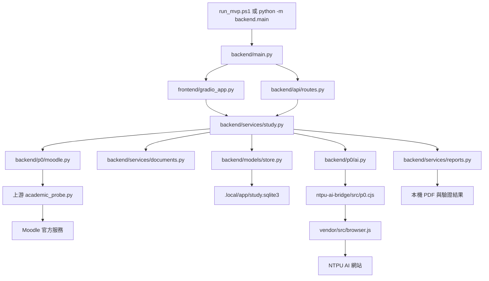

# 專案檔案導覽：每個檔案在做什麼

更新日期：2026-11-04。依目前實際程式整理，涵蓋專案原始碼、設定、文件、測試與引入的上游模組。
安裝套件與執行產物依類型列在最後，方便在 VS Code 檔案總管辨識。

## 直接完成作業與恢復新增檔案（2026-11-04）

| 檔案 | 用途 |
| --- | --- |
| `backend/agent/completion.py` | 直接完成作業的固定工具流程、來源快照、資料集／統計、隔離執行與成果報告 |
| `skills/assignment-completer/SKILL.md` | 按題目語言產生具體成果，以真實證據區分提案、執行結果與阻塞事項 |
| `tests/test_completion.py` | 直接完成的核准、來源、公開資料、API 與阻塞結果 |
| `tests/test_completion_format.py` | 成果報告格式、語言、來源標籤與未完成內容判定 |
| `tests/test_completion_retries.py` | checkpoint 續跑、連續三次失敗、成功後歸零與立即停止條件 |
| `tests/test_completion_best_effort.py` | 非致命工具失敗後保留作業、待辦完整性與語言、致命錯誤仍停止 |
| `tests/test_completion_ui.py` | 一鍵入口、執行進度與自動前往審閱頁 |
| `tests/test_generation_recovery.py` | AI 連線恢復、重新生成、獨立逾時與續跑預算 |
| `tests/test_export_recovery.py` | PDF 品質失敗的可用格式保留、來源快照相容性與 ZIP hash 驗證 |
| `tests/test_prepare_live.py` | 真人準備腳本的首門課／首份作業選取及空資料處理 |
| `tests/test_runner_config.py` | Docker CLI 尋找、保存 context 與舊設定相容 |

原有 `tests/test_p3_sandbox.py` 另包含直接完成模式的真實容器執行；所有 AI 回覆使用合成資料。

## P4 新增檔案（2026-11-04）

| 檔案 | 用途 |
| --- | --- |
| `backend/services/learning.py` | 儀表板、課程彙整、FTS5 搜尋與本機五步驟進度 |
| `backend/services/exports.py` | DOCX 產生、ZIP 明確清單打包、雜湊與審閱檢查 |
| `frontend/learning.py` | 首頁總覽、課程專頁、搜尋結果與來源連結 |
| `tests/test_p4.py` | 搜尋／課程／帳號隔離、恢復與匯出回歸 |
| `docs/P4_VALIDATION.md` | 本次選定範圍、資料遷移、驗收與限制 |

## P3 新增檔案（2026-11-03）

| 檔案 | 用途 |
| --- | --- |
| `backend/agent/contracts.py` | TaskPlan、工具白名單、JSON Schema、執行預算、CSV 程式模板 |
| `backend/agent/engine.py` | LangGraph 工具流程、核准執行、持久檢查點、重試／取消、Crossref、統計重算與圖表 |
| `backend/agent/runner.py` | Docker CLI 隔離執行、限制輸出、逾時清理；不在宿主機執行 Python 輸入 |
| `runner/Dockerfile`、`runner/supervisor.py` | 最小標準函式庫映像與容器內輸出收集 |
| `frontend/agent_tools.py` | 工具計畫預覽、分級核准、教材與 CSV 選取、執行紀錄和續跑 |
| `scripts/setup_runner.py` | 選擇 Docker Linux context、建置並實際檢查 Runner，成功後保存不可變 image ID 與 context |
| `scripts/validate_p3.py` | 執行合成或真實 Runner gate，保存每案例成功／失敗原因 |
| `tests/test_p3.py`、`tests/test_p3_sandbox.py` | 合成流程與真實 Docker 隔離測試分離 |
| `skills/{academic-research,coding-assistant,data-analysis,reference-checker}/SKILL.md` | 操作指引與證據要求，不能授權工具 |
| `docs/P3_VALIDATION.md` | 使用方式、Runner 安裝、驗收證據與未完成 Gate |

## 1. 第一次看，先讀這五個檔案

1. [README.md](../README.md)：如何安裝、啟動與使用。
2. [backend/main.py](../backend/main.py)：整個 MVP 的啟動入口。
3. [frontend/gradio_app.py](../frontend/gradio_app.py)：畫面、按鈕，以及操作後觸發的動作。
4. [backend/services/study.py](../backend/services/study.py)：同步作業、組合資料、AI 任務、審閱與匯出的主要流程。
5. [backend/models/store.py](../backend/models/store.py)：資料如何保存到 SQLite。

一般開發以 `backend/main.py` 為入口；畫面按鈕大多直接呼叫 `StudyService`。
`backend/api/routes.py` 另外提供 HTTP API，供腳本或其他介面使用。

## 2. 從啟動到 PDF 的關係

`backend/p0/` 裡的 Moodle、Vault、AI Adapter 仍由 P1 使用；名稱有 `p0` 不代表整個目錄已停用。

## 3. 根目錄與 CI

| 檔案 | 用途 | 什麼時候看／修改 |
| --- | --- | --- |
| [README.md](../README.md) | 專案入口文件，包含啟動指令、操作流程、安裝方式與資料位置。 | 第一次執行或調整安裝／操作說明。 |
| [NTPU_HomeworkInOne_Dark_spec.md](../NTPU_HomeworkInOne_Dark_spec.md) | 完整產品規格，定義 P0～P6、技術選擇、功能範圍與驗收條件。 | 決定下一階段做哪些功能時。規格中的規劃目錄不一定與目前實作完全相同。 |
| [pyproject.toml](../pyproject.toml) | Python 版本、直接依賴、開發工具、pytest／Ruff 設定，以及 Pillow 安全版本覆寫。 | 新增 Python 套件或調整測試／格式規則時。 |
| [uv.lock](../uv.lock) | uv 產生的完整 Python 依賴鎖定檔，記錄可重現安裝的版本與來源。 | 套件版本更新時由 uv 更新，通常不手動編輯。 |
| [.gitignore](../.gitignore) | 定義 Git 忽略的套件目錄、個人資料、瀏覽器 Profile、快取與日誌。 | 新增執行產物或本機專用目錄時。 |
| [THIRD_PARTY_NOTICES.md](../THIRD_PARTY_NOTICES.md) | 記錄上游專案、引入範圍、第三方套件與字型授權。 | 引入程式碼、套件、字型或更新來源版本時。 |
| [.github/workflows/ci.yml](../.github/workflows/ci.yml) | GitHub Actions：安裝固定依賴、跑測試與 Ruff、檢查私人檔案、執行來源契約與漏洞掃描。 | 調整 PR／push 的自動檢查流程時。 |

## 4. 後端入口與 HTTP API

| 檔案 | 用途 |
| --- | --- |
| [backend/__init__.py](../backend/__init__.py) | 空的 Python 套件標記，讓 `backend` 可以被匯入，沒有獨立業務流程。 |
| [backend/main.py](../backend/main.py) | 建立 FastAPI、StudyService 和 Gradio；掛上 `/api`；處理本機 session cookie、Host／Origin 檢查與安全錯誤回覆；啟動 `127.0.0.1:8766`，印出當次解鎖網址。 |
| [backend/api/__init__.py](../backend/api/__init__.py) | `backend.api` 的空套件標記。 |
| [backend/api/routes.py](../backend/api/routes.py) | API 路由與 Pydantic 請求格式：連線、課程、作業、附件下載／解析、任務核准／取消、草稿、PDF 匯出、產物下載及 SSE 事件。功能主要交給 StudyService 執行。 |

## 5. 後端主要流程與資料保存

| 檔案 | 用途 |
| --- | --- |
| [backend/services/__init__.py](../backend/services/__init__.py) | `backend.services` 的空套件標記。 |
| [backend/services/study.py](../backend/services/study.py) | `StudyService` 是主要業務流程：確認本人帳號、同步課程／作業、補查作業敘述、下載及解析附件、組合 AI 節錄、建立與核准任務、檢查來源 hash、呼叫 AI、保存草稿、人工審閱與匯出。也處理使用者分區、重複請求與中斷狀態。 |
| [backend/services/documents.py](../backend/services/documents.py) | 將 Moodle HTML 轉文字；整理 `intro`、`activity` 和課程頁描述；解析 PDF／DOCX／TXT／CSV；保留來源位置與解析限制；以規則建立可編輯需求清單。 |
| [backend/services/reports.py](../backend/services/reports.py) | 準備 Noto Sans TC 字型，用 ReportLab 將 Markdown 標題、段落與表格輸出成 PDF；加入頁碼，並用 PyMuPDF 檢查文字、空白頁、邊界與字型嵌入。 |
| [backend/models/__init__.py](../backend/models/__init__.py) | `backend.models` 的空套件標記。 |
| [backend/models/store.py](../backend/models/store.py) | `Store` 封裝 SQLite 讀寫。`records` 表依 `user_id / kind / id` 保存課程、作業、附件、任務 JSON；`events` 表保存任務狀態事件。提供單筆／批次保存、查詢與交易處理。 |

### StudyService 裡常用的入口

| 想追的行為 | 方法 |
| --- | --- |
| 登入或恢復 Moodle | `login()`、`adopt_vault()`、`verify_identity()` |
| 同步課程與作業文字 | `sync_courses()`、`sync_assignments()` |
| 下載附件、整理 AI 輸入 | `download()`、`parse_assignment()` |
| 建立與核准 AI 任務 | `create_task()`、`approve()` |
| 送 AI、接結果、整理草稿 | `_run()`、`format_result()` |
| 停止、編輯、匯出 | `cancel()`、`save_draft()`、`export()` |

## 6. P0 驗證與持續沿用的整合模組

| 檔案 | 用途 | P1 是否使用 |
| --- | --- | --- |
| [backend/p0/__init__.py](../backend/p0/__init__.py) | `backend.p0` 的空套件標記。 | 匯入套件時使用。 |
| [backend/p0/moodle.py](../backend/p0/moodle.py) | 載入固定版本的 NTPUOne Moodle 探針；`Vault` 使用 OS 憑證儲存；`MoodleProbe` 負責登入、課程／作業與附件；另外實作下載網址、DNS、檔案大小、PDF/DOCX 檢查。 | **是**，P1 的 Moodle 與 Vault 基礎。 |
| [backend/p0/ai.py](../backend/p0/ai.py) | `AIAdapter` 啟動 Node 子程序，以 stdin/stdout JSON 訊息溝通；背景讀取任務結果，提供 RPC、開始任務與關閉介面。 | **是**，P1 的 Python → Node 接口。 |
| [backend/p0/evidence.py](../backend/p0/evidence.py) | 定義專案路徑，將白名單欄位的驗證事件寫進 `.local/p0/evidence.jsonl`；拒絕任意新增欄位，避免原始秘密進入驗證日誌。 | Moodle 整合仍會記錄部分驗證事件；P1 也引用專案根目錄常數。 |
| [backend/p0/gate.py](../backend/p0/gate.py) | 根據驗證事件判斷 P0 六項 Gate，區分離線測試與真實整合證據。 | P0 工作台／狀態查詢使用，沒有掛進 P1 主畫面。 |
| [backend/p0/app.py](../backend/p0/app.py) | P0 Gradio 驗證工作台，使用 `8765` 埠，操作 Moodle 登入／下載、NTPU AI 登入、10 次文字測試、文件傳遞及取消測試。 | 作為獨立驗證入口保留；一般使用者啟動 MVP 不跑它。 |

## 7. 前端畫面

| 檔案 | 用途 |
| --- | --- |
| [frontend/__init__.py](../frontend/__init__.py) | `frontend` 的空 Python 套件標記。 |
| [frontend/gradio_app.py](../frontend/gradio_app.py) | Gradio 首頁、五步驟獨立畫面、直接完成作業、連線管理、草稿預覽與匯出；包含 callback、CSS、進度恢復與核准清除規則。 |
| [frontend/connections.py](../frontend/connections.py) | 連線管理彈窗、登入狀態檢查與 Moodle／校務／AI 登入交接。 |
| [frontend/navigation.py](../frontend/navigation.py) | 首頁與各步驟的切換、步驟提示與直接完成模式導覽。 |

要改按鈕名稱、欄位順序、預設需求、配色或錯誤提示，先看 `frontend/gradio_app.py`。
要改按下按鈕後的同步、核准或匯出規則，接著看 `backend/services/study.py`。

## 8. Node AI Bridge

| 檔案 | 用途 |
| --- | --- |
| [ntpu-ai-bridge/package.json](../ntpu-ai-bridge/package.json) | Bridge 的 Node 版本要求與最小直接依賴：playwright-core、sharp；另有 JavaScript 語法檢查指令。 |
| [ntpu-ai-bridge/package-lock.json](../ntpu-ai-bridge/package-lock.json) | npm 產生的精確依賴鎖定檔，供 `npm ci` 安裝一致版本。 |
| [ntpu-ai-bridge/src/p0.cjs](../ntpu-ai-bridge/src/p0.cjs) | Node 子程序入口。接收 Python 的 `health`、登入／恢復、`start_task`、`cancel_task`、`shutdown` 等訊息，轉交 BrowserBridge，回傳結果或固定錯誤碼。雖然檔名有 p0，**目前 MVP 仍用這個入口**。 |
| [ntpu-ai-bridge/vendor/manifest.json](../ntpu-ai-bridge/vendor/manifest.json) | 引入的上游 commit 與逐檔 SHA-256；測試會核對 vendor 檔案是否仍與來源一致。 |
| [ntpu-ai-bridge/vendor/LICENSE](../ntpu-ai-bridge/vendor/LICENSE) | 跟著引入模組一起保留的上游 MIT 授權。 |

### 保留的上游 JavaScript 檔案

這些檔案由固定版本的 `ntpu-ai-vscode` 複製而來。調整本專案接線時先改 `src/p0.cjs`；
若要修改 vendor，需一併處理來源紀錄與一致性測試。

| 檔案 | 用途 |
| --- | --- |
| [ntpu-ai-bridge/vendor/src/browser.js](../ntpu-ai-bridge/vendor/src/browser.js) | `BrowserBridge` 核心：開啟專用瀏覽器、等待本人登入、透過網站介面送訊息、觀察網站串流、取得回覆、取消與關閉。 |
| [ntpu-ai-bridge/vendor/src/browser/manager.js](../ntpu-ai-bridge/vendor/src/browser/manager.js) | 探索 Chrome／Edge／Chromium 執行檔、檢查獨立 Profile 路徑、啟動瀏覽器及設定登入視窗。 |
| [ntpu-ai-bridge/vendor/src/browser/diagnostics.js](../ntpu-ai-bridge/vendor/src/browser/diagnostics.js) | 整理瀏覽器失敗階段與原因，遮蔽 Cookie／URL 等資訊，再產生診斷。Python 接口會再轉成固定錯誤碼。 |
| [ntpu-ai-bridge/vendor/src/browser/response-watchdog.js](../ntpu-ai-bridge/vendor/src/browser/response-watchdog.js) | 控制模型回覆的閒置逾時及總等待上限，避免串流無限占用任務。 |
| [ntpu-ai-bridge/vendor/src/security/guard.js](../ntpu-ai-bridge/vendor/src/security/guard.js) | 辨識受保護路徑及可能的秘密，提供內容遮蔽、物件清理與外送文字檢查。 |
| [ntpu-ai-bridge/vendor/src/security/attachments.js](../ntpu-ai-bridge/vendor/src/security/attachments.js) | 上游的二進位附件核准與掃描器，檢查大小、類型、內容與掃描證明。P1 目前在 Python 解析文件後送文字，沒有向它傳入實體附件。 |
| [ntpu-ai-bridge/vendor/src/security/offline-ocr.js](../ntpu-ai-bridge/vendor/src/security/offline-ocr.js) | 上游離線 OCR 的工作執行緒管理：序列化辨識、逾時及終止 worker。P1 目前不啟用這條 OCR 路徑。 |
| [ntpu-ai-bridge/vendor/src/security/ocr-worker.js](../ntpu-ai-bridge/vendor/src/security/ocr-worker.js) | 上游 Tesseract OCR worker，限制辨識期間網路存取並回傳文字。P1 最小依賴未安裝它所需的 Tesseract 套件，不能因檔案存在就視為 OCR 可用。 |

## 9. 開發、啟動與驗證腳本

| 檔案 | 用途 | 執行時會做什麼 |
| --- | --- | --- |
| [scripts/run_mvp.ps1](../scripts/run_mvp.ps1) | 一般 MVP 啟動腳本。 | 切到專案根目錄、設定 Python UTF-8，以 `.venv` 執行 `backend.main`。 |
| [scripts/run_p0.ps1](../scripts/run_p0.ps1) | P0 驗證工作台啟動腳本。 | 啟動 `backend.p0.app`；真人 AI 測試由工作台上的核准操作觸發。 |
| [scripts/setup_dev.ps1](../scripts/setup_dev.ps1) | 建置開發環境。 | clone／確認固定上游版本、`uv sync --locked`、準備字型、安裝最小 Node Bridge 依賴。會連網下載來源與套件。 |
| [scripts/setup_font.py](../scripts/setup_font.py) | 安裝 PDF 使用的開放中文字型。 | 讀 font.lock.json，必要時下載 Noto Sans TC、核對 hash，再建立可渲染的固定字重字型。 |
| [scripts/vendor_bridge.py](../scripts/vendor_bridge.py) | 重新產生上游模組子集。 | 從 `.upstream/ntpu-ai-vscode` 複製指定模組與 License 到 vendor，重建逐檔 hash manifest；會覆寫對應 vendor 檔案。 |
| [scripts/check_repository.py](../scripts/check_repository.py) | Git 內容的基本私人檔案與秘密掃描。 | 檢查已追蹤及可加入 Git 的檔案，拒絕個人產物／資料目錄與明顯的長字串憑證賦值；不是完整的資安稽核器。 |
| [scripts/p0_status.py](../scripts/p0_status.py) | 查詢 P0 Gate。 | 讀本機去識別化證據，印出各項是否通過。 |
| [scripts/live_status.py](../scripts/live_status.py) | 查詢本機任務狀態。 | 讀 SQLite，僅輸出任務編號、狀態、錯誤、審閱與 QA 欄位，不輸出草稿全文。 |
| [scripts/prepare_live.py](../scripts/prepare_live.py) | 本人課程的真人驗收輔助腳本。 | 透過已啟動 MVP 的 API 與本機解鎖網址，恢復目前登入者的 Moodle，選取回傳的第一門課程及該課程第一份作業並下載附件。沒有課程或作業時對應欄位留空；無附件時節錄與要求留空，仍覆寫準備結果，不保留舊選取。不會送 AI。 |
| [scripts/qa_live_pdf.py](../scripts/qa_live_pdf.py) | 最近一份已完成 PDF 的視覺 QA 準備。 | 從 SQLite 找到已完成任務，渲染每頁 PNG 到 `.local/qa/pdf/`，並輸出 PDF 檢查結果。實際版面仍需看渲染圖確認。 |

平常執行產品使用 `run_mvp.ps1`；修改安裝環境看 `setup_dev.ps1`。
`prepare_live.py` 與 `qa_live_pdf.py` 是開發驗收輔助工具，沒有掛在日常啟動流程。

## 10. Skills 流程文件

| 檔案 | 用途 | 目前接線方式 |
| --- | --- | --- |
| [skills/assignment-reader/SKILL.md](../skills/assignment-reader/SKILL.md) | 說明如何依題目節錄整理需求、保留 file_id／頁碼及標示缺漏。 | StudyService 組合 AI 請求時會讀入內容。 |
| [skills/report-writer/SKILL.md](../skills/report-writer/SKILL.md) | 依題目指定語言產生草稿，未指定時使用繁體中文；規範結構化 JSON、來源與 TODO，不編造實驗結果。 | StudyService 組合 AI 請求時會讀入內容。 |
| [skills/pdf-generator/SKILL.md](../skills/pdf-generator/SKILL.md) | 記錄人工審閱後的本機 PDF 渲染與驗證流程。 | 目前是流程規範文件；實際執行邏輯寫在 reports.py，沒有動態 Skill 執行器。 |

## 11. 測試檔案

| 檔案 | 驗證內容 |
| --- | --- |
| [tests/test_p0.py](../tests/test_p0.py) | 下載網址與 DNS 限制、PDF／DOCX 安全與解析、來源版本、vendor 完整性、P0 證據與 Gate、stdio 契約、本機頁面存取限制。 |
| [tests/test_mvp.py](../tests/test_mvp.py) | 使用 FakeAI 與合成文件驗證 P1：核准、來源快照、重複請求、跨帳號拒絕、失敗保留草稿、中文 PDF、重啟讀取、API、DOCX／CSV 與快取失敗處理。 |
| [tests/test_assignment_text.py](../tests/test_assignment_text.py) | 作業網頁文字：敘述／活動指示去重、只取老師題目、相同作業 module 補查、無附件任務／API、文字快照、變更後核准失效與空文字錯誤。 |

這三份測試使用合成資料或 mock，不會自行登入學校或將真實作業送給 AI。
真實端到端結果另外寫在驗收文件。

## 12. 文件與版本來源紀錄

| 檔案 | 用途 |
| --- | --- |
| [docs/FILE_GUIDE.md](FILE_GUIDE.md) | 就是本文，逐檔說明用途、主要呼叫關係與修改入口。 |
| [docs/API.md](API.md) | 本機 API 端點、登入 cookie、請求欄位、核准、狀態與下載方式。 |
| [docs/ADR-001-ai-adapter.md](ADR-001-ai-adapter.md) | 記錄為什麼採 Python＋Node stdio BrowserBridge，以及來源重用、介面與驗證結論。 |
| [docs/ASSIGNMENT_TEXT.md](ASSIGNMENT_TEXT.md) | 記錄作業敘述與活動指示的來源、補查方式、無附件操作與實測限制。 |
| [docs/AUTHORIZATION.md](AUTHORIZATION.md) | 記錄提出者對來源程式碼使用授權範圍的陳述與測試課程範圍。 |
| [docs/SECURITY.md](SECURITY.md) | 本機存取、憑證、附件、AI 核准與套件安全邊界；也說明 Gradio／Pillow 相容覆寫。 |
| [docs/P0_VALIDATION.md](P0_VALIDATION.md) | P0 真實整合與測試結果，包含來源、登入、附件與 AI Gate。 |
| [docs/P1_VALIDATION.md](P1_VALIDATION.md) | P1 初版端到端驗收、PDF QA、當時測試結果及已知限制；後續作業文字更新另見 ASSIGNMENT_TEXT.md。 |
| [docs/sources.lock.json](sources.lock.json) | 固定 NTPUOne 與 ntpu-ai-vscode 的 repository URL、commit SHA、授權註記與 checkout 路徑。 |
| [docs/font.lock.json](font.lock.json) | 固定 Noto Sans TC 下載來源 commit、URL 與 SHA-256，供字型安裝腳本驗證。 |

## 13. 授權原文

| 檔案 | 用途 |
| --- | --- |
| [LICENSES/NTPUOne.txt](../LICENSES/NTPUOne.txt) | 保存 NTPUOne 原始著作權及權利保留聲明，與提出者授權紀錄一併閱讀。 |
| [LICENSES/ntpu-ai-vscode.txt](../LICENSES/ntpu-ai-vscode.txt) | 保存 ntpu-ai-vscode 的 MIT 授權原文。 |
| [LICENSES/NotoSansTC-OFL.txt](../LICENSES/NotoSansTC-OFL.txt) | 保存 Noto Sans TC 的 SIL Open Font License 原文；字型本體放在本機資料目錄。 |

## 14. 執行後出現的資料與套件

下列項目由工具或執行流程建立，已在 `.gitignore` 排除；不需要逐個閱讀其中的套件原始碼。

| 目錄／檔案類型 | 內容與產生者 |
| --- | --- |
| `.venv/` | uv 建立的 Python 虛擬環境與安裝套件；包含專案啟動使用的 Python 執行檔。 |
| `ntpu-ai-bridge/node_modules/` | npm 安裝的 Bridge 依賴，版本由 package-lock.json 控制。 |
| `.upstream/NTPUOne/` | 固定版本的原始上游 checkout。P1 會載入其中 `scripts/academic_probe.py` 的官方 Moodle 唯讀邏輯。 |
| `.upstream/ntpu-ai-vscode/` | 固定版本的 AI Extension 來源，供來源核對、vendor 複製與上游測試使用；P1 的 Node 程序載入本專案 vendor 副本。 |
| `.cache/`、`.pytest_cache/`、`.ruff_cache/`、`__pycache__/` | 套件下載、測試、Ruff 與 Python 編譯快取。 |
| `.git/` | Git 的版本資料與設定。 |
| `.local/app/study.sqlite3` | Store 寫入的課程、作業、附件 metadata、任務與事件。 |
| `.local/app/study.sqlite3-wal`、`.local/app/study.sqlite3-shm` | SQLite 執行期間使用的交易／共享記憶體輔助檔。 |
| `.local/app/active-user.json` | 最近使用的本機使用者雜湊識別，供重新啟動時選對資料分區；不是 Moodle Token。 |
| `.local/app/launch-url.txt` | 當次啟動的本機解鎖網址，每次啟動換發。 |
| `.local/app/runner.json` | 本機 Docker 不可變映像 ID 與 context，只有 Runner 建置與實際執行檢查成功才保存。 |
| `.local/app/incoming/` | 下載器初步保存並檢查的附件，以 hash 命名。 |
| `.local/app/assets/<user_hash>/` | 依本人帳號分區保存的附件原檔。 |
| `.local/app/prepared-live.json` | prepare_live.py 準備的驗收資料，含選定來源與文件節錄。 |
| `.local/app/workspaces/<user_hash>/<task_id>/input/` | 當次任務的附件副本；若有作業網頁文字，也保存 `assignment-description.txt`。 |
| 同一任務的 `extracted/assignment_requirements.json` | 當次核准的要求清單及來源 hash。 |
| 同一任務的 `work/report.md` | 可編輯、可恢復的 Markdown 草稿。 |
| 同一任務的 `output/report.pdf` | 使用者審閱後產生的 PDF。 |
| 同一任務的 `output/manifest.json` | 來源／產物 hash、模型任務識別、Skill 版本、工具摘要與 PDF QA 紀錄。 |
| 同一任務的 `logs/task_events.redacted.jsonl` | 匯出時整理的狀態與固定錯誤碼紀錄。 |
| `.local/p0/` | P0 證據、已下載附件與 P0 工作台解鎖網址。 |
| `.local/fonts/` | 下載的 Noto Sans TC 與轉出的固定字重 TTF。 |
| `.local/qa/` | 驗收畫面、PDF 分頁渲染圖與 QA JSON。 |
| `.local/` 裡其他 audit／安裝日誌，以及根目錄 `.p0-*.log` | 開發時的依賴掃描、安裝與測試輸出。 |

Moodle Token 由 OS Vault 管理，不在以上 JSON 或 SQLite 保存。
NTPU AI 專用 Profile 目前位於 `%LOCALAPPDATA%/NTPU HomeworkInOne/p0/browser-profiles/`，
由 BrowserManager 建立；它位在專案外，與日常瀏覽器及 Git 資料分開。

## 15. 想修改某個功能，從哪裡開始

| 要修改的功能 | 建議閱讀順序 |
| --- | --- |
| 畫面、按鈕、欄位、提示文字 | frontend/gradio_app.py |
| 作業敘述／活動指示漏抓 | study.py 的 sync_assignments → documents.py 的 assignment_text → tests/test_assignment_text.py |
| PDF／Word／CSV 解析 | documents.py → p0/moodle.py 的 inspect_document → tests/test_mvp.py、tests/test_p0.py |
| Moodle 登入、Token、下載限制 | p0/moodle.py → study.py 的同步／下載流程 |
| AI 要怎麼回答、草稿格式 | skills/assignment-reader、skills/report-writer → study.py 的 _run、format_result |
| 直接完成作業、公開資料與自動重試 | skills/assignment-completer → agent/completion.py → agent/engine.py → tests/test_completion*.py |
| Docker context、隔離與 Windows 長路徑 | agent/runner.py → scripts/setup_runner.py → tests/test_runner_config.py、tests/test_p3_sandbox.py |
| AI 連線、取消、逾時 | p0/ai.py → ntpu-ai-bridge/src/p0.cjs → vendor/src/browser.js |
| 核准規則、來源快照、重複請求 | study.py 的 create_task、approve |
| 資料保存、歷史任務 | models/store.py → study.py → frontend/gradio_app.py |
| PDF 字型、版面、表格、頁碼 | services/reports.py → scripts/setup_font.py → docs/font.lock.json |
| 對外提供新 HTTP API | api/routes.py → services/study.py → docs/API.md |
| 安裝依賴、CI、來源更新 | pyproject.toml、package.json → setup_dev.ps1、ci.yml → THIRD_PARTY_NOTICES.md |

新增、刪除或搬動維護檔案時，請同步更新本文與 README 的入口連結。
# P2 新增檔案（2026-11-03）

| 檔案 | 用途 |
| --- | --- |
| `backend/integrations/__init__.py` | 唯讀校務整合套件。 |
| `backend/integrations/sis.py` | 校務 CSRF 登入、精確 bridge 白名單、記憶體 Session 與本人身份。 |
| `backend/integrations/sis_parser.py` | 固定上游課表、成績、排名、畢業進度 Parser；未知格式停止或標示未知。 |
| `backend/integrations/moodle.py` | 沿用上游唯讀函式白名單，加入受限 HTTP transport。 |
| `backend/integrations/transport.py` | 請求節流、bounded retry、Retry-After 冷卻、回應大小上限。 |
| `backend/integrations/materials.py` | 教材原檔下載、MIME／檔頭／ZIP／Office／hash 檢查，不執行。 |
| `backend/services/data_hub.py` | 獨立來源快照、指定學期、多課同步、教材／公告／本人評分、課程對應。 |
| `frontend/data_hub.py` | 學習資料中心的校務表格、教材、公告、評分、快取狀態與人工對應。 |
| `tests/test_sis.py` | 合成校務 Parser／登入／身份／限流契約。 |
| `tests/test_data_hub.py` | 多課同步、快取、舊作業可見性、對應衝突、API 與 AI 隱私邊界。 |
| `tests/test_materials.py` | 原檔下載、格式、壓縮 HTTP、巨集／ZIP 限制、檔名安全。 |
| `docs/P2_VALIDATION.md` | 工程驗證結果、限制與待完成的真人 Gate。 |
| `docs/P2_DATA_MODEL.md` | 新增 records kinds、相容方式、來源與 Parser 契約。 |

`study.py` 已接上 DataHub，作業新增 hidden/removed；`routes.py` 新增 P2 API，
`main.py` 回報 v0.2.0。前述 P1 檔案導覽保留作為原流程說明；P2 不取代既有 AI／PDF 流程。
